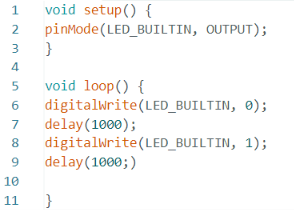
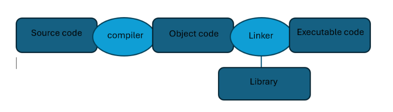

# nodemcu-01
Under veckan har vi blivit introducerade till mikroprocessorer, Arduino och C++. Därför kommer en liten förklaring av vad jag hunnit lära mig hittills. 

## Arduino och C++
Vi har skrivit C++ i Arduino IDE. Här nedan förklaras lite av det man bör ha koll som nybörjare.

* void setup - Det som skrivs här kommer att köras först och bara en gång. Tex etablera kontakt med en sensor. 
* void loop - Det som skrivs här kommer att köras efter det i void setup och kommer att göra det om och om igen. Tex läsa av värden från sensor.

Här är ett exempel på kod, skrivet i Arduino med C++, som får en inbyggd led-lampa på en mikrocontroller att tändas och släckas med en sekunds mellanrum. 

Där det nu står 0 och 1 kan man också skriva andra instruktioner. Tex high och low.  

## Överföra till mikroprocessor  
När man har skrivit sin kod kan man tyvärr inte bara koppla en sladd mellan sin dator och mikroprocessorn. Det är några steg som man måste göra för att kunna föra över sin kod till mikroprocessorn. Dessa visas i bilden nedan.
 

* Source code - Det här är människoskriven kod som skrivs i ett programmeringsspråk.
* Compiler - Här översätts source code till object code.
* Object code - Kod som är översatt till ettor och nollor.
* Linker - Här görs det möjligt att länka in kod från library.
* Library - Det här är ett bibliotek med färdig kod för olika element som man kan länka till i sin egen kod. 
* Executable file - Den slutgiltiga koden som är redo att laddas över till mikroprocessorn.

## ESD i samband med mikroprocessorer
ESD står för electrostatic discharge vilket på svenska är elektrostatisk urladdning. Det är en rusning av statisk laddning från ett objekt till ett annat. Exempel på det är åska och när man får en stöt av ett föremål. Detta kan vara skadligt för elektronik. Därför vill vi inte röra vid pinnarna på en mikroprocessor och riskera att den går sönder.

#### Hur man kan undvika det:
* ESD-matta som är kopplad till jord.
* ESD-armband som är kopplat till jord.
* Rör inte vid pinnarna. Rör själva kortet eller sätt det på en svamp och rör vid svampen.
